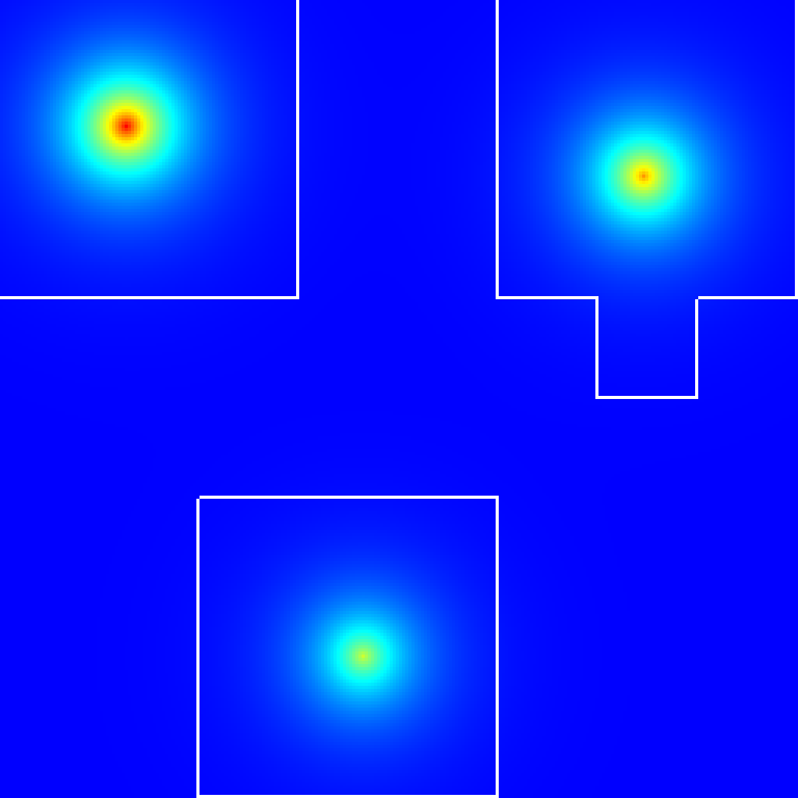
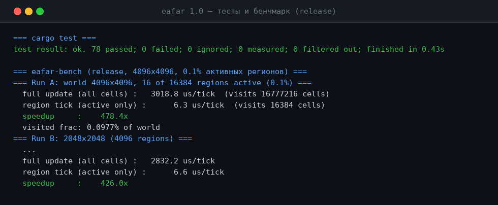

# EAFAR

### Update only what changed.

**EAFAR — Event-Driven Asynchronous Fuzzy Automata Runtime — a zero-dependency Rust library and
a design paradigm for large sparse worlds: state lives in SoA fields, only changed regions wake
up, behavior is automata + events + fuzziness, and runs are bit-exact reproducible artifacts.**

[**English**](README.md) · [Русский](README.ru.md)

[](https://github.com/kostyk348/eafar/actions/workflows/ci.yml)
[](https://github.com/kostyk348/eafar/releases)
[](https://github.com/kostyk348/eafar/blob/main/LICENSE)


---

## What is EAFAR?

Three principles, one small crate, no dependencies:

| Principle | Meaning | EAFAR mechanism |
| --- | --- | --- |
| **Everything is a field** (SoA) | State lives in typed columnar fields, not per-object components | 6 SoA `f32` fields (Temperature, Humidity, Energy, Radiation, Population, Corruption) |
| **Update only what changed** | Inactive regions sleep; only dirty regions step | 32×32 regions with idle aging, deterministic ascending-id iteration |
| **Behavior = automata + events + fuzziness** | Cascades, async clocks, smooth membership transitions | `EventQueue` → `RegionScheduler` → `AutomatonManager` → `FuzzyState` → `DiffusionEngine` |

### The key insight: sparsity is free — but only where nothing changes

The dense synchronous model recomputes every cell every generation. EAFAR's region scheduler
keeps an **active set** `A_t` and steps only awake regions; the cost tracks the active fraction,
not the world size. Measured with the shipped benchmark (`cargo run --release --bin eafar-bench`;
shared Linux sandbox, 2 vCPU — relative values meaningful, absolute values are not; full context
and methodology in [docs/benchmarks.md](docs/benchmarks.md)):

| workload (1024×1024, 300 gens) | active-cell ratio | wall-time speedup, sparse vs dense | determinism |
| --- | --- | --- | --- |
| Conway Life (chaotic soup) | 99.7% | **0.84×** (event machinery is overhead here — dense wins) | identical hashes, sparse == dense |
| heat diffusion (decays to zero) | 2.2% | **13.7×** | identical hashes, sparse == dense |
| threshold contagion (SIR wave) | 4.2% | **34.2×** | identical hashes, sparse == dense |
| 16 of 16 384 regions active (legacy microbench, 4096×4096) | 0.098% of cells | **~500–750×** (region tick flat ~6–7 µs) | — |

The gain follows `≈ 1/α` of the active fraction `α`, minus scheduler bookkeeping — the
formalization (active set, wake/sleep lifecycle, cost model, locality/frame-size trade-off,
deterministic hashing) lives in [docs/model.md](docs/model.md).

| The sparse world (outlined = awake) | Tests + bench (real output) |
| --- | --- |
|  |  |

## Building blocks (S1–S10 + reference workloads)

| Module | File | What it does |
| --- | --- | --- |
| S1 `FieldMap` | `src/field_map.rs` | 6 SoA float fields, bounded access, `bitwise_equal` |
| S2 `EventQueue` | `src/event_queue.rs` | FIFO queue, per-type handlers, cascades (Lightning → Fire → Smoke → Plants), seq numbers |
| S3 `RegionScheduler` | `src/region_scheduler.rs` | 32×32 regions, sleep/wake with idle aging, deterministic ascending-id iteration |
| S4 `AutomatonManager` | `src/automaton.rs` | Asynchronous automata, per-automaton period (Fire@60Hz … Evolution@1h) |
| S5 `FuzzyState` | `src/fuzzy.rs` | Membership functions (step/ramp/triangle/bell) — swap behavior without editing code |
| S6 `DependencyGraph` | `src/dependency.rs` | Declares automaton→field access, structural validation, no automaton→automaton edges |
| S7 `DiffusionEngine` | `src/diffusion.rs` | Single engine, per-process rules (kernel/rate/decay/ambient), cross-boundary reads |
| S8 `WorldSnapshot` | `src/snapshot.rs` | **Bit-exact** capture/restore — NaN patterns and `-0.0` survive rollback (`f32::to_bits`) |
| S9 `SplitMix64` | `src/rng.rs` | Deterministic replay: same seed → same history (bit-identical to the C++ original) |
| S10 `Visualizer` | `src/visualizer.rs` | Dependency-free PNG/CSV heatmap export, region overlay, sleeping-cell stats |
| + `workload` | `src/workload.rs` | Reference CA rules (Conway / heat / threshold contagion) with **dense vs sparse drivers**, `SessionCheckpoint` (true rewind), FNV-1a state hash |
| + `viz` | `viz/` | Interactive egui visualizer (see below) |

```
use eafar::prelude::*;                     // everything above, one import
```

## The visualizer (interactive demo)

`viz` is a workspace crate with an egui/eframe window: the CA grid rendered live, active regions
outlined, play/pause/step/rewind over a ring buffer of recent states, workload selector
(Conway / heat / contagion), seed control, live stats (generation, active ratio, changed cells,
events/s, state hash). Clicking the world injects an event — you can watch the wake propagate.

```
cargo run --release -p viz --features gui      # the window (needs cargo >= 1.85, see below)
cargo test -p viz                              # the GUI-independent logic: rewind buffer, stats, playback
```

Two honest notes, by design:

* The **GUI is a demo, not a product** — no packaging, no config, no accessibility story; it
  exists to inspect the engine and to demo the wake/sleep lifecycle.
* The `gui` feature needs **cargo ≥ 1.85** (parts of the egui/eframe dependency tree ship
  edition-2024 manifests; on cargo 1.83 `cargo check -p viz --features gui` fails with
  `feature 'edition2024' is required`). The crate's *logic* (rewind buffer, stats, playback,
  frame capture/restore) is dependency-free of egui and builds/tests on older stable toolchains.
  The committed root `Cargo.lock` pins the whole `viz` tree; CI checks the GUI on stable
  (non-blocking job `viz-check`).

## Determinism

Same seed + same event sequence → **bit-identical** history and world state. Snapshots restore
bit-exact (including NaN bit patterns). Replay after rollback reproduces the identical final
state. This is what makes EAFAR suitable for scientific use: runs are reproducible artifacts.
The port is tested against the original: SplitMix64 reference vectors and the C++ contract
suite are part of the 98 Rust tests — including the audit property suite
(`tests/suite/determinism.rs`): same seed → identical state hash across runs (sparse and dense),
the sparse event-driven driver reproduces the dense trajectory bit-exactly, checkpoint/restore
rewind + replay is bit-exact, seeded event injection is reproducible, different seeds diverge.

## Quick start

```
cargo build --release
cargo test                                        # 98 tests (contract + determinism + viz logic)
cargo run --release --example heatmap heat.png    # the sparse-world picture above
cargo run --release --bin eafar-bench             # the numbers above
cargo run --release -p viz --features gui         # the interactive visualizer (cargo >= 1.85)
```

```rust
use eafar::prelude::*;

let mut world = FieldMap::new(1024, 1024);
let mut sched = RegionScheduler::new(1024, 1024, 32)?;
sched.wake(500, 500)?;                            // only this region will step
```

## Generalization layers (built on the core)

| Domain instantiation | What maps to | Core building block |
| --- | --- | --- |
| **Spatial simulation** | the original target | all of the above |
| **GUI / UI** | dirty-region rendering = region scheduler; undo = snapshot/rollback; UI tests = replay — `viz/` is the working demo | `WorldSnapshot`, `EventQueue`, `RegionScheduler` |
| **Database** (→ EAFAR-DB) | columnar SoA storage, sparse pages = sleeping regions, materialized views = automata, transactions = snapshot/rollback, audit = replay | `FieldMap`, `WorldSnapshot` |
| **Games** | sparse open worlds (most of the map sleeps), deterministic lockstep (same seed → same state), event cascades as game logic | all of the above, `SplitMix64` |

The core library is **domain-free** — no GUI, no DB engine, no game logic. Those are *layers*
built on the core.

## Honesty (what we do and don't claim)

* **Performance claims are bound to the benchmark.** Every overhead/speedup statement in this
  README refers to a specific workload, world size and active fraction, and is reproduced by
  `cargo run --release --bin eafar-bench` — the full methodology, machine context and caveats
  are in [docs/benchmarks.md](docs/benchmarks.md). On a fully awake world (Conway soup, 99.7%
  active) the event machinery is a measured **0.84×** — slower than dense; the win is exactly
  the settling part of a workload, tracking `≈ 1/α`.
* **Fuzzy semantics before fuzzy performance.** The fuzzy layer today is membership functions
  (step/ramp/triangle/bell) plus a named registry ([docs/model.md §6](docs/model.md) lists
  exactly what exists). t-norms, t-conorms, implication, rule inference and defuzzification are
  **not implemented**; therefore no fuzzy-inference performance claim is made anywhere, and any
  future such claim must first define and benchmark those operators.
* **The visualizer is a demo, not a product** (see above), and the sparse-vs-dense table is
  generated by a real binary run — never hand-written numbers.

## From C++ to Rust

EAFAR v0.1 was a C++23 library (still in git history). v1.0.0 is the same runtime as a pure
Rust crate: edition 2021, **zero dependencies** (the `viz` demo crate lives outside the core
and is the only place third-party crates appear), `#![forbid(unsafe_code)]`, `Result` instead of
exceptions, `BTreeSet` for the deterministic iteration order the C++ code guaranteed by
convention. The contract suite was ported 1:1 and extended (98 tests vs 72+), including
bit-exact rollback, SplitMix64 reference vectors and the determinism/replay property suite.

## Scope

**In (core library):** spatial state, event-driven scheduling, async automata, fuzzy membership,
diffusion, dependency analysis, deterministic replay, reference workloads, visualization exports.

**Out of the core (by design):** NPCs, inventory, ECS, game logic, AI, scripting, GUI, OpenGL —
none of this ships *inside* the runtime. The core is domain-free so that it can serve any
domain; GUI, databases, and game logic are layers built on the core.

## Releases

| Version | What | When |
| --- | --- | --- |
| **Unreleased** | audit upgrade: formal model, dense-vs-sparse benchmark suite, determinism/replay property tests, `viz` egui demo, honesty section | 2026-11 |
| **v1.0.0** | Rust rewrite: zero-dependency crate, 78 tests, bench + CI ported; C++ superseded | 2026-10-30 |
| **v0.1.0** | C++23 first snapshot: S1–S10, 72+ contract tests, CMake + MinGW script | 2026-10-16 |

## Limitations (honest ones)

See [LIMITATIONS.md](LIMITATIONS.md). Notably: single-threaded ticks, `f32` fields with
strict float ordering (no fast-math shortcuts), stored-deflate PNG export (uncompressed), a
fixed 8-event type set in `EventType`, no systematic region-size sweep yet, and the GUI build
needing cargo ≥ 1.85.

## Contributing

PRs welcome — see [CONTRIBUTING.md](CONTRIBUTING.md). Changes are tracked in
[CHANGELOG.md](CHANGELOG.md).

## License

Apache-2.0 — see [LICENSE](LICENSE).

**EAFAR** — the world sleeps; the change wakes it.
