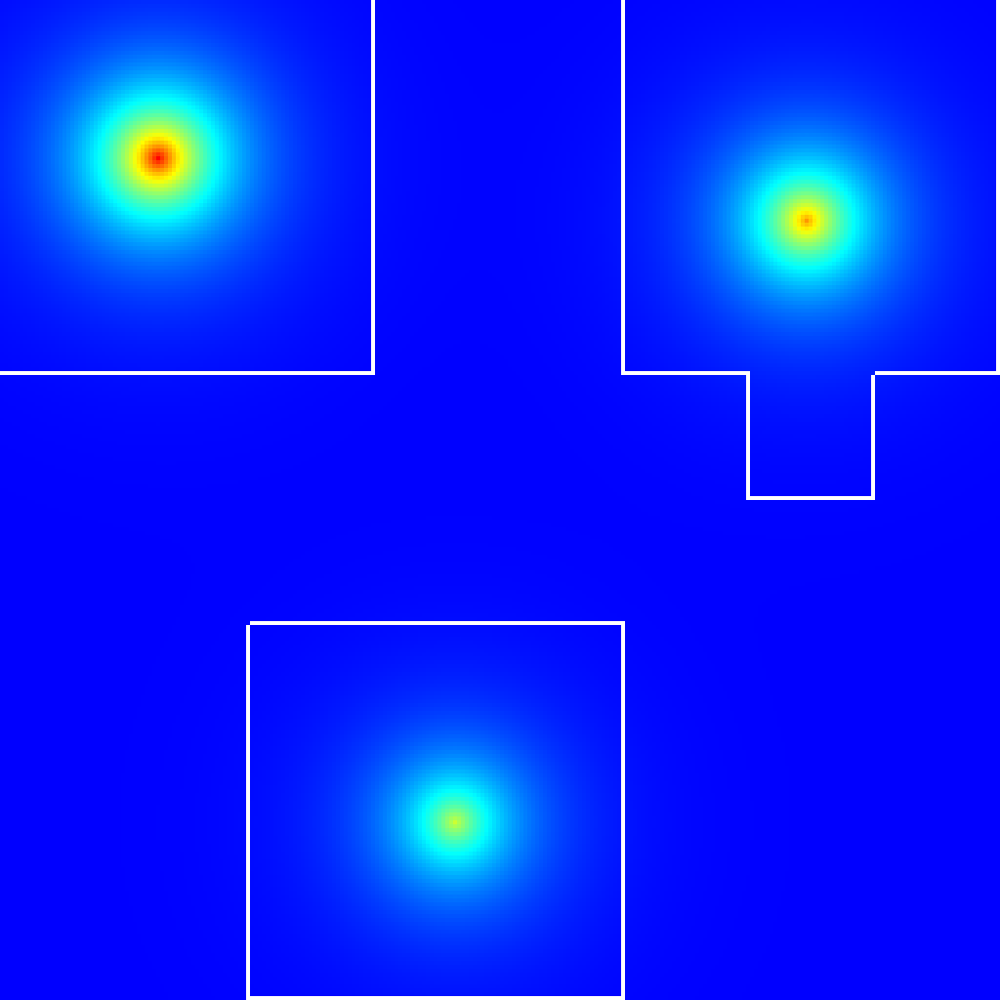
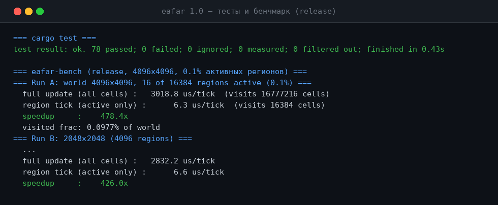

# EAFAR

### Обновляйте только то, что изменилось.

**EAFAR — Event-Driven Asynchronous Fuzzy Automata Runtime — крейт на чистом Rust без единой
зависимости и парадигма для больших разреженных миров: состояние живёт в SoA-полях, просыпаются
только изменённые регионы, поведение — это автоматы + события + нечёткость, а прогоны
воспроизводимы бит-в-бит.**

[English](README.md) · [**Русский**](README.ru.md)

---

## Что такое EAFAR?

Три принципа, один небольшой крейт, ноль зависимостей:

| Принцип | Смысл | Механизм EAFAR |
| --- | --- | --- |
| **Всё — поле** (SoA) | Состояние живёт в типизированных колонках, а не в компонентах объектов | 6 SoA-полей `f32` (Temperature, Humidity, Energy, Radiation, Population, Corruption) |
| **Обновляй только изменённое** | Спящие регионы не шагают; шагают только «грязные» | Регионы 32×32 с постарением от простоя, детерминированный обход по возрастанию id |
| **Поведение = автоматы + события + нечёткость** | Каскады, асинхронные такты, плавные переходы принадлежности | `EventQueue` → `RegionScheduler` → `AutomatonManager` → `FuzzyState` → `DiffusionEngine` |

### Главный инсайт: разреженность бесплатна

Классические сеточные симуляции обновляют мир 4096×4096 каждый тик — 16.8M ячеек впустую.
Планировщик регионов EAFAR усыпляет дремлющие регионы; цена тика не растёт вместе с миром,
потому что от активного **набора**, а не от размера мира. Замерено штатным бенчмарком
(`cargo run --release --bin eafar-bench`):

| мир | активных регионов | полное обновление | тик активных | ускорение |
| --- | --- | --- | --- | --- |
| 4096×4096 | 16 / 16 384 (0.1%) | 3018.8 µs/тик | 6.3 µs/тик | **478×** |
| 2048×2048 | 16 / 4 096 | 722.4 µs/тик | 6.2 µs/тик | **117×** |

| Разреженный мир (обведено = не спит) | Тесты + бенчмарк (реальный вывод) |
| --- | --- |
|  |  |

## Строевые блоки (S1–S10)

| Модуль | Файл | Что делает |
| --- | --- | --- |
| S1 `FieldMap` | `src/field_map.rs` | 6 SoA-полей float, доступ с границами, `bitwise_equal` |
| S2 `EventQueue` | `src/event_queue.rs` | FIFO-очередь, обработчики по типам, каскады (Молния → Огонь → Дым → Растения), seq-номера |
| S3 `RegionScheduler` | `src/region_scheduler.rs` | регионы 32×32, сон/пробуждение с постарением, детерминированный обход по возрастанию id |
| S4 `AutomatonManager` | `src/automaton.rs` | асинхронные автоматы, свой период у каждого (Fire@60Гц … Evolution@1ч) |
| S5 `FuzzyState` | `src/fuzzy.rs` | функции принадлежности (step/ramp/triangle/bell) — поведение меняется без правки кода |
| S6 `DependencyGraph` | `src/dependency.rs` | декларация доступа автомат→поле, структурная валидация, без рёбер автомат→автомат |
| S7 `DiffusionEngine` | `src/diffusion.rs` | один движок, правила по процессу (ядро/скорость/распад/фон), чтения через границы |
| S8 `WorldSnapshot` | `src/snapshot.rs` | **бит-в-бит** захват/восстановление — паттерны NaN и `-0.0` переживают откат (`f32::to_bits`) |
| S9 `SplitMix64` | `src/rng.rs` | детерминированный реплей: тот же сид → та же история (бит-в-бит совпадает с C++-оригиналом) |
| S10 `Visualizer` | `src/visualizer.rs` | экспорт PNG/CSV-хитмапы без зависимостей, обводка регионов, статистика спящих ячеек |

```
use eafar::prelude::*;                     // всё перечисленное — одним импортом
```

## Детерминизм

Тот же сид + та же последовательность событий → **бит-в-бит** та же история и состояние мира.
Снапшоты восстанавливаются точно (включая битовые паттерны NaN). Реплей после отката
воспроизводит идентичное финальное состояние. Поэтому EAFAR пригоден для научного применения:
прогоны — воспроизводимые артефакты. Перенос проверен против оригинала: референсные векторы
SplitMix64 и контрактный набор C++ входят в 78 Rust-тестов.

## Быстрый старт

```
cargo build --release
cargo test                                        # 78 контрактных тестов
cargo run --release --example heatmap heat.png    # картинка разреженного мира выше
cargo run --release --bin eafar-bench             # цифры выше
```

```rust
use eafar::prelude::*;

let mut world = FieldMap::new(1024, 1024);
let mut sched = RegionScheduler::new(1024, 1024, 32)?;
sched.wake(500, 500)?;                            // шагать будет только этот регион
```

## Слои обобщения (над ядром)

| Инстанциация | Во что отображается | Блок ядра |
| --- | --- | --- |
| **Пространственная симуляция** | исходная цель | всё перечисленное |
| **GUI** | отрисовка грязных регионов = планировщик; undo = снапшот/откат; UI-тесты = реплей | `WorldSnapshot`, `EventQueue` |
| **База данных** (→ EAFAR-DB) | колоночное SoA-хранилище, разреженные страницы = спящие регионы, материализованные представления = автоматы, транзакции = снапшот/откат, аудит = реплей | `FieldMap`, `WorldSnapshot` |
| **Игры** | разреженные открытые миры (большая часть карты спит), детерминированный lockstep (один сид → одно состояние), каскады событий как игровая логика | всё перечисленное, `SplitMix64` |

Ядро **предметно-свободно** — ни GUI, ни движка БД, ни игровой логики. Это *слои* над ядром.

## Из C++ в Rust

EAFAR v0.1 был библиотекой на C++23 (осталась в истории git). v1.0.0 — тот же рантайм крейтом
на чистом Rust: edition 2021, **ноль зависимостей**, `#![forbid(unsafe_code)]`, `Result` вместо
исключений, `BTreeSet` для детерминированного порядка обхода, который в C++ держался
конвенцией. Контрактный набор перенесён один-в-один и расширен (78 тестов против 72+),
включая бит-точный откат и референсные векторы SplitMix64.

## Scope

**В ядре:** пространственное состояние, планирование по событиям, асинхронные автоматы,
нечёткая логика, диффузия, анализ зависимостей, детерминированный реплей, экспорт визуализаций.

**Вне ядра (по замыслу):** NPC, инвентарь, ECS, игровая логика, AI, скриптинг, GUI, OpenGL —
ничего из этого не поставляется *внутри* рантайма. Ядро предметно-свободно, чтобы служить
любому домену; GUI, БД и игровая логика — слои над ядром.

## Релизы

| Версия | Что | Когда |
| --- | --- | --- |
| **v1.0.0** | Переписывание на Rust: крейт без зависимостей, 78 тестов, бенчмарк и CI перенесены; C++ заменён | 2026-10-30 |
| **v0.1.0** | Первый снимок на C++23: S1–S10, 72+ контрактных тестов, CMake + скрипт MinGW | 2026-10-16 |

## Ограничения (честный список)

См. [LIMITATIONS.md](LIMITATIONS.md). Главное: такты однопоточны, поля `f32` со строгим
порядком операций (никаких fast-math сокращений), PNG-экспорт без сжатия (stored-deflate),
фиксированный набор из 8 типов событий в `EventType`.

## Дорожная карта

* ✅ Ядро S1–S10 (C++ → Rust)
* ⬜ EAFAR-DB: колоночный слой хранения с разреженными страницами и материализованными представлениями
* ⬜ Опциональные параллельные такты регионов (за feature-флагом — ядро остаётся без зависимостей)
* ⬜ Хелпер детерминированного сетевого lockstep (сид + обмен журналом событий)
* ⬜ Демо GUI-слоя: отрисовка грязных регионов поверх `RegionScheduler`

## Contributing

PR приветствуются — см. [CONTRIBUTING.md](CONTRIBUTING.md). Изменения фиксируются в
[CHANGELOG.md](CHANGELOG.md).

## Лицензия

Apache-2.0 — см. [LICENSE](LICENSE).

**EAFAR** — мир спит; изменение его будит.
