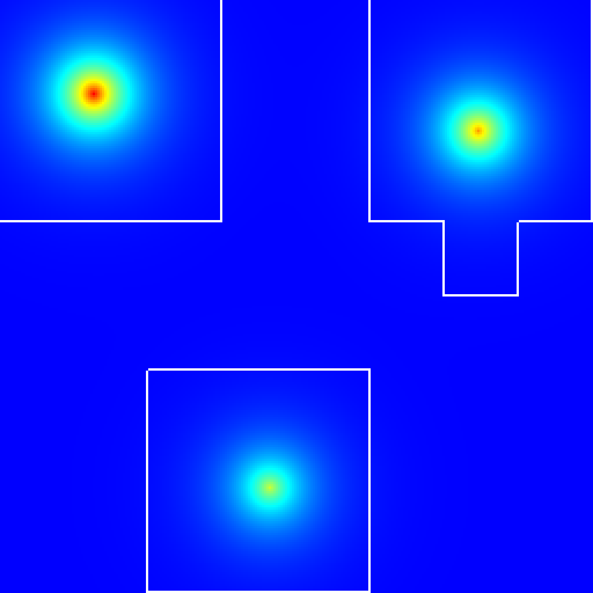
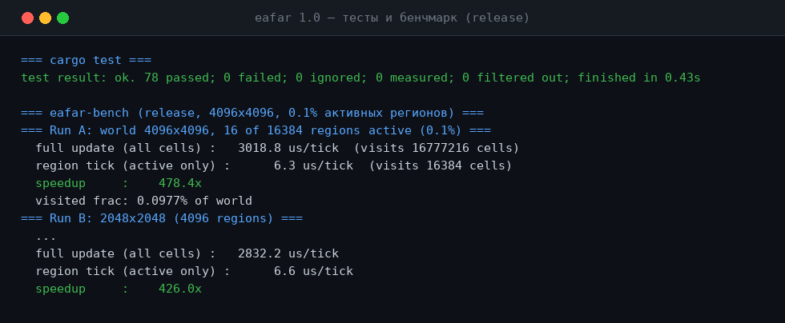

# EAFAR

### Обновляйте только то, что изменилось.

**EAFAR — Event-Driven Asynchronous Fuzzy Automata Runtime — крейт на чистом Rust без единой
зависимости и парадигма для больших разреженных миров: состояние живёт в SoA-полях, просыпаются
только изменённые регионы, поведение — это автоматы + события + нечёткость, а прогоны
воспроизводимы бит-в-бит.**

[English](README.md) · [**Русский**](README.ru.md)

[](https://github.com/kostyk348/eafar/actions/workflows/ci.yml)
[](https://github.com/kostyk348/eafar/releases)
[](https://github.com/kostyk348/eafar/blob/main/LICENSE)


---

## Что такое EAFAR?

Три принципа, один небольшой крейт, ноль зависимостей:

| Принцип | Смысл | Механизм EAFAR |
| --- | --- | --- |
| **Всё — поле** (SoA) | Состояние живёт в типизированных колонках, а не в компонентах объектов | 6 SoA-полей `f32` (Temperature, Humidity, Energy, Radiation, Population, Corruption) |
| **Обновляй только изменённое** | Спящие регионы не шагают; шагают только «грязные» | Регионы 32×32 с постарением от простоя, детерминированный обход по возрастанию id |
| **Поведение = автоматы + события + нечёткость** | Каскады, асинхронные такты, плавные переходы принадлежности | `EventQueue` → `RegionScheduler` → `AutomatonManager` → `FuzzyState` → `DiffusionEngine` |

### Главный инсайт: разреженность бесплатна — но только там, где ничего не меняется

Плотная синхронная модель пересчитывает каждую ячейку каждый ход. Планировщик регионов EAFAR
держит **активное множество** `A_t` и шагает только не спящие регионы; цена следует за активной
долей, а не за размером мира. Замерено штатным бенчмарком (`cargo run --release --bin eafar-bench`;
общая Linux-песочница, 2 vCPU — относительные значения значимы, абсолютные — нет; полный контекст
и методика в [docs/benchmarks.md](docs/benchmarks.md)):

| нагрузка (1024×1024, 300 ходов) | доля активных ячеек | ускорение sparse против dense | детерминизм |
| --- | --- | --- | --- |
| Conway Life (хаотичный суп) | 99,7% | **0,84×** (обвязка событий здесь — чистый оверхед, dense выигрывает) | хэши совпадают, sparse == dense |
| тепловая диффузия (затухает в ноль) | 2,2% | **13,7×** | хэши совпадают, sparse == dense |
| пороговое заражение (SIR-волна) | 4,2% | **34,2×** | хэши совпадают, sparse == dense |
| 16 из 16 384 регионов активны (легаси-микробенч, 4096×4096) | 0,098% ячеек | **~500–750×** (тик региона стабилен ~6–7 мкс) | — |

Ускорение следует закону `≈ 1/α` от активной доли `α` минус накладные расходы планировщика —
формализация (активное множество, жизненный цикл сна/пробуждения, модель стоимости, компромисс
локальности/размера кадра, детерминированное хэширование) — в [docs/model.md](docs/model.md).

| Разреженный мир (обведено = не спит) | Тесты + бенчмарк (реальный вывод) |
| --- | --- |
|  |  |

## Строевые блоки (S1–S10 + референсные нагрузки)

| Модуль | Файл | Что делает |
| --- | --- | --- |
| S1 `FieldMap` | `src/field_map.rs` | 6 SoA-полей float, доступ с границами, `bitwise_equal` |
| S2 `EventQueue` | `src/event_queue.rs` | FIFO-очередь, обработчики по типам, каскады (Молния → Огонь → Дым → Растения), seq-номера |
| S3 `RegionScheduler` | `src/region_scheduler.rs` | регионы 32×32, сон/пробуждение с постарением, детерминированный обход по возрастанию id |
| S4 `AutomatonManager` | `src/automaton.rs` | асинхронные автоматы, свой период у каждого (Fire@60Гц … Evolution@1ч) |
| S5 `FuzzyState` | `src/fuzzy.rs` | функции принадлежности (step/ramp/triangle/bell) — поведение меняется без правки кода |
| S6 `DependencyGraph` | `src/dependency.rs` | декларация доступа автомат→поле, структурная валидация, без рёбер автомат→автомат |
| S7 `DiffusionEngine` | `src/diffusion.rs` | один движок, правила по процессу (ядро/скорость/распад/фон), чтения через границы |
| S8 `WorldSnapshot` | `src/snapshot.rs` | **бит-в-бит** захват/восстановление — паттерны NaN и `-0.0` переживают откат (`f32::to_bits`) |
| S9 `SplitMix64` | `src/rng.rs` | детерминированный реплей: тот же сид → та же история (бит-в-бит совпадает с C++-оригиналом) |
| S10 `Visualizer` | `src/visualizer.rs` | экспорт PNG/CSV-хитмапы без зависимостей, обводка регионов, статистика спящих ячеек |
| + `workload` | `src/workload.rs` | референсные правила CA (Conway / тепло / пороговое заражение) с **плотным и разреженным драйверами**, `SessionCheckpoint` (честная перемотка), FNV-1a-хэш состояния |
| + `viz` | `viz/` | интерактивный egui-визуализатор (см. ниже) |

```
use eafar::prelude::*;                     // всё перечисленное — одним импортом
```

## Визуализатор (интерактивное демо)

`viz` — крейт рабочего пространства с окном на egui/eframe: живая сетка CA, обводка активных
регионов, play/pause/step/rewind по кольцевому буферу недавних состояний, выбор нагрузки
(Conway / тепло / заражение), управление сидом, живая статистика (поколение, активная доля,
изменённые ячейки, события/с, хэш состояния). Клик по миру внедряет событие — видно, как
распространяется пробуждение.

```
cargo run --release -p viz --features gui      # окно (нужен cargo >= 1.85, см. ниже)
cargo test -p viz                              # логика без GUI: буфер отката, статистика, воспроизведение
```

Две честные оговорки, намеренно:

* **GUI — это демо, а не продукт**: никакой упаковки, конфигурации и истории доступности; он
  существует, чтобы инспектировать движок и показывать жизненный цикл сна/пробуждения.
* Сборка с фичей `gui` требует **cargo ≥ 1.85** (часть дерева зависимостей egui/eframe несёт
  манифесты edition 2024; на cargo 1.83 `cargo check -p viz --features gui` падает с
  `feature 'edition2024' is required`). *Логика* крейта (буфер отката, статистика,
  воспроизведение, захват/восстановление кадров) от egui не зависит и собирается/тестируется
  и на старых стабильных тулчейнах. Корневой `Cargo.lock` в репозитории пинит всё дерево `viz`;
  CI проверяет GUI на стабильном тулчейне (неблокирующая джоба `viz-check`).

## Детерминизм

Тот же сид + та же последовательность событий → **бит-в-бит** та же история и состояние мира.
Снапшоты восстанавливаются точно (включая битовые паттерны NaN). Реплей после отката
воспроизводит идентичное финальное состояние. Поэтому EAFAR пригоден для научного применения:
прогоны — воспроизводимые артефакты. Перенос проверен против оригинала: референсные векторы
SplitMix64 и контрактный набор C++ входят в 98 Rust-тестов — включая свойство-набор аудита
(`tests/suite/determinism.rs`): тот же сид → идентичный хэш состояния между запусками (sparse
и dense), разреженный драйвер воспроизводит плотную траекторию бит-в-бит, откат чекпоинта +
реплей бит-точны, внедрение событий по сиду воспроизводимо, разные сиды расходятся.

## Быстрый старт

```
cargo build --release
cargo test                                        # 98 тестов (контракт + детерминизм + логика viz)
cargo run --release --example heatmap heat.png    # картинка разреженного мира выше
cargo run --release --bin eafar-bench             # цифры выше
cargo run --release -p viz --features gui         # интерактивный визуализатор (cargo >= 1.85)
```

```rust
use eafar::prelude::*;

let mut world = FieldMap::new(1024, 1024);
let mut sched = RegionScheduler::new(1024, 1024, 32)?;
sched.wake(500, 500)?;                            // шагать будет только этот регион
```

## Слои обобщения (над ядром)

| Инстанциация | Во что отображается | Блок ядра |
| --- | --- | --- |
| **Пространственная симуляция** | исходная цель | всё перечисленное |
| **GUI** | отрисовка грязных регионов = планировщик; undo = снапшот/откат; UI-тесты = реплей — `viz/` это работающее демо | `WorldSnapshot`, `EventQueue`, `RegionScheduler` |
| **База данных** (→ EAFAR-DB) | колоночное SoA-хранилище, разреженные страницы = спящие регионы, материализованные представления = автоматы, транзакции = снапшот/откат, аудит = реплей | `FieldMap`, `WorldSnapshot` |
| **Игры** | разреженные открытые миры (большая часть карты спит), детерминированный lockstep (один сид → одно состояние), каскады событий как игровая логика | всё перечисленное, `SplitMix64` |

Ядро **предметно-свободно** — ни GUI, ни движка БД, ни игровой логики. Это *слои* над ядром.

## Честность (что мы утверждаем, а что нет)

* **Заявления о производительности привязаны к бенчмарку.** Каждое утверждение об оверхеде/ускорении
  в этом README относится к конкретной нагрузке, размеру мира и активной доле и воспроизводится
  командой `cargo run --release --bin eafar-bench` — полная методика, контекст машины и оговорки
  в [docs/benchmarks.md](docs/benchmarks.md). На полностью проснувшемся мире (суп Конвея, 99,7%
  активности) обвязка событий даёт измеренные **0,84×** — медленнее dense; выигрыш даёт именно
  затухающая часть нагрузки и следует закону `≈ 1/α`.
* **Семантика нечёткости — прежде заявлений о её производительности.** Нечёткий слой сегодня —
  это функции принадлежности (step/ramp/triangle/bell) и именованный реестр
  ([docs/model.md §6](docs/model.md) перечисляет, что именно есть). t-нормы, t-конормы,
  импликация, вывод правил и дефаззификация **не реализованы**; поэтому нигде нет заявлений о
  производительности нечёткого вывода, а любое будущее такое заявление обязано сначала определить
  и замерить эти операторы.
* **Визуализатор — демо, а не продукт** (см. выше), а таблица sparse-vs-dense сгенерирована
  реальным запуском бинарника — числа никогда не пишутся руками.

## Из C++ в Rust

EAFAR v0.1 был библиотекой на C++23 (осталась в истории git). v1.0.0 — тот же рантайм крейтом
на чистом Rust: edition 2021, **ноль зависимостей** (демо-крейт `viz` живёт вне ядра и является
единственным местом, где появляются сторонние крейты), `#![forbid(unsafe_code)]`, `Result` вместо
исключений, `BTreeSet` для детерминированного порядка обхода, который в C++ держался
конвенцией. Контрактный набор перенесён один-в-один и расширен (98 тестов против 72+),
включая бит-точный откат, референсные векторы SplitMix64 и свойство-набор детерминизма/реплея.

## Scope

**В ядре:** пространственное состояние, планирование по событиям, асинхронные автоматы,
нечёткая принадлежность, диффузия, анализ зависимостей, детерминированный реплей, референсные
нагрузки, экспорт визуализаций.

**Вне ядра (по замыслу):** NPC, инвентарь, ECS, игровая логика, AI, скриптинг, GUI, OpenGL —
ничего из этого не поставляется *внутри* рантайма. Ядро предметно-свободно, чтобы служить
любому домену; GUI, БД и игровая логика — слои над ядром.

## Релизы

| Версия | Что | Когда |
| --- | --- | --- |
| **Unreleased** | апгрейд по аудиту: формальная модель, набор бенчмарков dense-vs-sparse, свойство-тесты детерминизма/реплея, egui-демо `viz`, раздел честности | 2026-11 |
| **v1.0.0** | Переписывание на Rust: крейт без зависимостей, 78 тестов, бенчмарк и CI перенесены; C++ заменён | 2026-10-30 |
| **v0.1.0** | Первый снимок на C++23: S1–S10, 72+ контрактных тестов, CMake + скрипт MinGW | 2026-10-16 |

## Ограничения (честный список)

См. [LIMITATIONS.md](LIMITATIONS.md). Главное: такты однопоточны, поля `f32` со строгим
порядком операций (никаких fast-math сокращений), PNG-экспорт без сжатия (stored-deflate),
фиксированный набор из 8 типов событий в `EventType`, пока нет систематического перебора
размера региона, а сборке GUI нужен cargo ≥ 1.85.

## Contributing

PR приветствуются — см. [CONTRIBUTING.md](CONTRIBUTING.md). Изменения фиксируются в
[CHANGELOG.md](CHANGELOG.md).

## Лицензия

Apache-2.0 — см. [LICENSE](LICENSE).

**EAFAR** — мир спит; изменение его будит.
